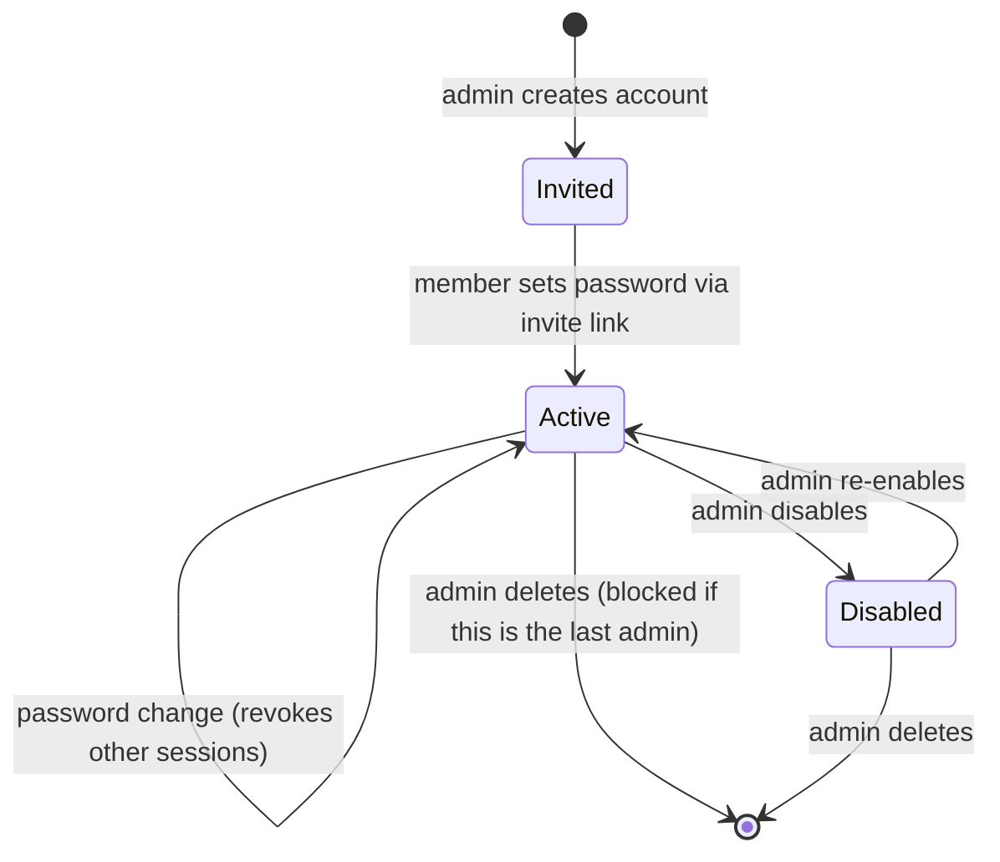

# Per-Member Authentication — Design Spec (Revised)

**Status:** Revised per independent review. Pending user approval before
`writing-plans`. Not implemented.

**Supersedes:** an earlier draft mistakenly committed to the old, now-parked
monorepo instead of this repo. That draft claimed a "genuine security
boundary between members" while leaving every company-data route publicly
reachable and never separating authentication from authorization. This
revision corrects both.

## What changed since the first draft, and why

| Gap in the first draft | Fix in this revision |
|---|---|
| `/api/ask`, `/api/overview`, and other company-data routes stayed public | §1: deny-by-default route matrix — only login, bootstrap, static assets, and a content-free health check stay public |
| Claimed "isolation" while every member shared one unrestricted index | §2: v1 is scoped explicitly as **authentication-only** — stated as a limitation, not solved, with a pilot connector restriction as the mitigating control |
| No plan for the existing shared `ADMIN_TOKEN` | §3: migrates to named admin sessions; `ADMIN_TOKEN` becomes a labeled break-glass path with a removal date |
| Bootstrap put a secret in a URL query string | §4: replaced with a local CLI command (`omnibrain user add --admin`) |
| No login-specific hardening (rate limits, timing, CSRF) | §5: made mandatory for v1, not a fast-follow |
| Raw session tokens stored at rest | §6: only a hash is ever persisted; the raw token is single-use-visible to the browser |
| No account lifecycle beyond "create" | §7: full lifecycle — invite tokens instead of admin-known passwords, disable, role change, session revocation, last-admin protection |
| "Manual curl evidence" as the test plan | §8: a real automated security-test list, curl reserved for what automation can't reach |
| SSO ruled out entirely | §9: kept out of v1, but the design leaves a named extension point so adding it later isn't a rewrite |
| Hosted-model support implied as this spec's next step | §10: explicitly severed into its own future spec; this feature stays local-model-only until that spec exists and is approved |

## Why this exists

Today `scripts/demo.ts` runs as a single implicit "me" persona. `lib/console/data.ts`'s
`loadMembers()` returns `gbrain auth clients` entries — API credentials for
federated brain access, not human logins. `config/people.json` is only an
alias-mapping file for connector attribution. Nothing distinguishes "who is
currently using this."

## Global constraints

- On-premise, self-hosted only for v1 — no external identity-provider
  dependency (§9 keeps the door open without requiring it now).
- No fabricated data or states.
- Match existing patterns: plain TypeScript, Bun-native APIs, `config/*.json`
  for local state, the `lib/util/http-security.ts` conventions (`ClientError`,
  `safeErrorResponse`, session-style gating parallel to the existing
  `requireAdmin`).
- Admin-invite-only account creation.
- **This service will eventually sit behind a reverse proxy on a network the
  customer controls but does not fully air-gap.** "An attacker must already
  be on the machine" is not an acceptable assumption anywhere in this design
  (this reverses an assumption the first draft made in §5/§6 of its own
  reasoning).

## 1. Route-access matrix (deny-by-default)

Every route not explicitly listed here requires, at minimum, a valid
session. This inverts the first draft's default.

| Route | Access level |
|---|---|
| `GET /` (login page shell) | Public |
| `POST /api/auth/login` | Public |
| `POST /api/auth/logout` | Session (any) |
| `GET /healthz` | Public — returns only `{status:"ok"}`/`{status:"down", failing:[...]}` with subsystem *names* (`ollama`, `gbrain`, `disk`), never counts, content, or paths |
| static login-page assets (css/js/fonts bundled with the login screen only) | Public |
| `POST /api/auth/bootstrap-check` (used only to decide whether to show "no accounts yet" vs. the login form) | Public, returns a boolean only |
| `GET /`, `/api/ask`, `/api/overview`, citations/source metadata, `/api/reviews`, `/api/activity`, `/api/access` (team info), `/api/connectors` (status only), automations, tasks | **Session required** (any role) |
| `POST /api/review-submit`, `POST /api/review-decide` | Session required; attribution uses the real logged-in user, not a hardcoded label |
| `POST /api/connectors/save`, `POST /api/connectors/test`, `POST /api/connectors/sync` | **Session + admin role** |
| `POST /api/auth/users` (create/disable/role-change) | **Session + admin role** |
| `POST /api/automations/create` | Session required (any role) — creating an automation is not a company-data read |
| Any future "my hosted-model key" endpoint | Session required; scoped to `user.id`, never another user's key (see §10 — not built in this spec) |

**Security invariant:** a request with no session cookie, an expired session,
or a disabled account's session must receive `401` from every row above the
public section — including on data it might otherwise consider harmless
(e.g. `/api/overview`'s counts). Nothing about "there's not much there"
excuses skipping the check. Verified by the automated test in §8.

## 2. Authentication vs. authorization — explicit v1 scope choice

Four distinct concerns, named separately so none of them get silently
conflated the way the first draft conflated authentication with isolation:

1. **Authentication** — who is logged in. Built in this spec.
2. **Application authorization** — which *actions* a role may perform (the
   member/admin route split in §1). Built in this spec.
3. **Source authorization** — which *indexed documents* a specific person
   may retrieve, propagated from each connector's own real permission model
   (a Notion page's sharing settings, a private Slack channel's membership,
   a restricted Drive folder's ACL). **Not built in this spec.**
4. **Ownership** — which personal keys/sessions/drafts belong to which
   user. Partially built (sessions are per-user; a personal hosted-model key
   is out of scope per §10).

**Chosen scope for this implementation: authentication-only pilot
foundation.** Every authenticated member can search the entire indexed
corpus, regardless of what they could see in the source systems directly.
This is a real, stated limitation, not a solved problem — the opposite of
the first draft's implicit claim.

**Mitigating control for the pilot (mandatory, not optional):** while
source-aware authorization doesn't exist, the pilot's connected sources
must not include HR, legal, finance, executive, or M&A content. This is a
connector-configuration policy enforced by what the admin chooses to
connect, not a technical control this spec builds — call it out prominently
in onboarding docs and the admin's first-login flow (a one-time acknowledgment
checkbox: "I understand every logged-in member can see everything indexed
here" before the first connector can be saved).

Real source-aware authorization (query-time, not just ingestion-time
filtering, per-connector ACL sync, negative-retrieval tests) is a separate,
much larger project — noted as required before any HR/legal/finance/M&A
content is ever connected, and out of scope for this spec.

## 3. Resolving the existing shared `ADMIN_TOKEN`

- `ADMIN_TOKEN` (from the P0 hardening work) **remains usable through the
  pilot**, but its role changes: it becomes a **break-glass credential**,
  not the normal path for administration.
- Once named admin sessions exist (this spec), every route currently gated
  by `requireAdmin(req, ADMIN_TOKEN)` additionally accepts a valid
  session belonging to a `role: "admin"` user. The token-based path is not
  removed in v1 (a locked-out admin with no other account needs a recovery
  path), but it is:
  - **Logged distinctly**: every action taken via `X-Admin-Token` is
    attributed to `"break-glass"` in the audit log (§6's schema), never to
    a named person — making it immediately visible in any audit review that
    this path was used, and how often.
  - **Documented as emergency-only** in `docs/SECURITY_INCIDENT_RUNBOOK.md`
    (already has a "leaked admin token" section — extend it to say routine
    administration should never use this path once accounts exist).
  - **Scheduled for removal**: once the pilot has run for one full session
    lifetime (7 days, see §6) with named admin accounts in active use, and
    at least one admin has confirmed they can recover a lost session without
    it, `ADMIN_TOKEN` support is removed in a follow-up change. Tracked as a
    dated follow-up item, not left open-ended.

## 4. Bootstrap without a URL token

Replaces the first draft's `/setup-account?token=...` entirely — a
query-string secret can leak into browser history, shared links,
screenshots, and reverse-proxy access logs.

```
omnibrain user add --admin
```

A local CLI command (new `scripts/user-add.ts`, wired into `bin/omnibrain`
the same way `doctor`/`setup` are) that:
- Prompts for name, email, and password interactively at the terminal.
- Reads the password with echo disabled (Node's `readline` supports this
  via a masked `Interface`, or Bun's `prompt`-equivalent — implementation
  detail for the plan, not this spec) — **never displayed on screen, never
  written to shell history, never logged**.
- Refuses to run with `--admin` if an admin already exists, unless run with
  an explicit `--force` a human must type deliberately (prevents silently
  creating a second uncoordinated "first" admin).
- Works identically for the true first account and for a later admin
  manually provisioning someone outside the invite-token flow (§7) if that
  flow is ever unavailable.

`POST /api/auth/bootstrap-check` (public, boolean-only) lets the login page
show "no accounts exist — an administrator must run `omnibrain user add
--admin` on the server" instead of a login form, without exposing anything
else.

## 5. Login protections (v1, mandatory)

- **Per-account and per-IP rate limiting**: reuse the existing
  `checkRateLimit`/`clientKey` infrastructure from `lib/util/http-security.ts`
  (already built for the P0 hardening) — e.g. 5 attempts / 5 minutes per
  account, 20 / 5 minutes per IP. Exceeding either returns a generic `429`.
- **Progressive delay**: each successive failed attempt for the same account
  within the rate-limit window adds an increasing artificial delay (e.g.
  `min(attempt * 400ms, 4s)`) before responding — cheap, effective friction
  against automated guessing that a hard rate limit alone doesn't fully stop.
- **Generic failure responses**: wrong email and wrong password return the
  identical `ClientError("invalid email or password", 401)` — never reveal
  which one was wrong.
- **Timing-resistant unknown-user handling**: when the email doesn't match
  any account, still run `Bun.password.verify` against a fixed dummy hash
  before returning the generic failure, so response timing doesn't
  distinguish "no such user" from "wrong password."
- **Audit events**: every login attempt (success or failure) and every
  logout writes an entry to the audit log (schema in §6) — including the
  outcome, the account (if resolvable), and the source IP.
- **CSRF/Origin protection**: since sessions are cookie-based, every
  state-changing request (`POST`/`PUT`/`DELETE`) must carry a matching
  `Origin` (or `Sec-Fetch-Site: same-origin`) header, checked server-side
  before the route handler runs; reject with `403` otherwise. This closes
  the gap a cookie-only design would otherwise have against a cross-site
  form/fetch from another origin, once this sits behind a reverse proxy
  reachable from more than `localhost`.
- **Configurable session expiration**: both an **absolute** expiry (7 days,
  matching §6 below) and an **idle** expiry (e.g. 24 hours of no activity)
  — whichever comes first ends the session. Configurable via
  `config/users.json`'s settings block, not hardcoded, since a real
  deployment's risk tolerance may differ from the pilot default.

## 6. Session storage

- **Token generation**: `crypto.randomBytes(32)` (32 bytes = 256 bits,
  exceeds the "at least 32 random bytes" bar), base64url-encoded for the
  cookie value.
- **What's persisted is never the raw token.** The server stores
  `sha256(token)` only. The raw token is returned to the browser exactly
  once (in the `Set-Cookie` response) and never again — a compromised
  `config/sessions.json` file cannot be replayed as a valid session, since
  presenting a session requires the raw token, not its hash.
- **Cookie attributes**: `HttpOnly; Secure; SameSite=Strict; Path=/`. (The
  `Secure` + `localhost`-exception caveat from the first draft still
  applies until this sits behind real TLS — tracked as a P0-09 dependency,
  already noted in the security checklist.)
- **Concurrency-safe store, without introducing a new dependency prematurely.**
  This server is a single Bun process — genuine SQL transactions solve a
  multi-process/multi-writer problem this process doesn't have. v1 uses an
  **in-process async write-mutex** (a simple queued lock around every
  `config/sessions.json` read-modify-write) combined with the existing
  tmp-file-then-rename atomic-write pattern already used throughout this
  codebase (`config/reviews.json`, `config/connectors.json`, etc.) — this
  makes concurrent requests to the same process safe without a new storage
  engine. **Explicitly flagged as a scaling limit, not a gap being missed**:
  if this process is ever run with multiple workers/instances behind a
  shared load balancer, this in-process lock stops being sufficient and
  session storage needs to move to a real shared store (SQLite/PGlite with
  real transactions, as the review suggested) — noted as a required
  follow-up before any multi-instance deployment, not before the pilot.
- **Filesystem permissions**: `config/sessions.json` created/maintained at
  mode `0600`, same requirement as the credential-storage fix already
  tracked for `config/connectors.json` (issue #9 in this repo's tracker).
- **Expired-session cleanup**: a sweep on every write (cheap, since writes
  already happen on login/logout) removes entries past their absolute or
  idle expiry — no unbounded growth.
- **Revocation**: 
  - Changing a password revokes every existing session for that account
    (increment `sessionVersion` on the user record — see §7's schema; a
    session is valid only if its stored `sessionVersion` matches the
    user's current one, avoiding needing to enumerate and delete every
    session row individually).
  - Disabling an account revokes all its sessions the same way.
  - A user can revoke their own other sessions ("log out everywhere") from
    their account settings; an admin can revoke any user's sessions.
- **Backups**: `scripts/backup-brain.sh` (existing, from the P1-12 work)
  backs up `~/.aletheia-brain` and `brain-sources/` — **`config/sessions.json`
  is explicitly excluded** from that backup path (add it to the script's
  exclusion list) so a restored backup can never revive old sessions; every
  restore requires fresh logins. Document this explicitly in
  `docs/BACKUP_RESTORE_RUNBOOK.md`.

## 7. Account lifecycle

### Schema

```ts
type User = {
  id: string;                 // "usr_..."
  name: string;
  email: string;               // stored lowercase/trimmed; uniqueness enforced on this normalized form
  passwordHash: string | null;  // null while an invite is pending
  role: "admin" | "member";
  active: boolean;              // false = disabled, sessions revoked, login refused
  createdAt: string;            // ISO
  passwordChangedAt: string | null;
  lastLoginAt: string | null;
  sessionVersion: number;       // incremented on password change / disable — invalidates old sessions
};

type Invite = {
  token: string;                // single-use, expiring
  userId: string;
  createdAt: string;
  expiresAt: string;            // short-lived, e.g. 48h
  usedAt: string | null;
};

type Session = {
  tokenHash: string;            // sha256(raw token) -- never the raw token
  userId: string;
  createdAt: string;
  lastSeenAt: string;           // updated on use, for idle-expiry
  expiresAt: string;            // absolute expiry
  sessionVersion: number;       // must match the user's current sessionVersion to be valid
};

type AuditEvent = {
  id: string;
  at: string;                   // ISO
  kind: "login_success" | "login_failure" | "logout" | "user_created"
      | "user_disabled" | "user_role_changed" | "password_changed"
      | "session_revoked" | "admin_token_used";
  actor: string;                 // user id, or "break-glass" for ADMIN_TOKEN-attributed actions, or "unknown" for a failed login against a nonexistent email
  target?: string;                // affected user id, where relevant
  sourceIp: string;
  detail?: string;                // short, non-sensitive context (never a password, never a token)
};
```

### Lifecycle diagrams



```mermaid
sequenceDiagram
    participant B as Browser
    participant S as Server
    participant Store as config/sessions.json

    B->>S: POST /api/auth/login {email, password}
    S->>S: verifyPassword (or dummy hash if unknown email)
    alt success
        S->>S: generate 32-byte token, sha256(token)
        S->>Store: append {tokenHash, userId, sessionVersion, expiresAt}
        S-->>B: Set-Cookie: tako_session=<raw token>; HttpOnly; Secure; SameSite=Strict
    else failure
        S-->>B: 401 generic "invalid email or password"
    end
```

### Flows this spec defines

- **Invite instead of admin-known passwords.** An admin creates an account
  with `name`/`email`/`role` only — no password. The system generates a
  single-use `Invite` token (48h expiry) and the admin communicates the
  invite link out of band (no email-sending capability exists in this
  product; building one is out of scope). The member visits the link,
  sets their own password, and the account becomes `active`. **The admin
  never knows another member's password at any point** — this replaces the
  first draft's "admin sets a temporary password" approach.
- **Password change** (self-service, requires current password):
  increments `sessionVersion`, revoking every other session immediately.
- **Admin-assisted reset**: admin triggers a new single-use `Invite` for an
  existing account (reuses the invite mechanism rather than a separate
  reset-token type); the account's old password stops working the moment
  the new one is set.
- **Disable**: sets `active: false`, increments `sessionVersion`. A disabled
  account cannot log in and has all sessions revoked immediately.
- **Delete**: hard-removes the user record. **Blocked if this would remove
  the last active admin** — the API returns a `ClientError(409)` explaining
  why, matching this codebase's existing pattern of explicit, named
  refusals rather than allowing a state the system can't recover from.
- **Role change**: admin ↔ member. Changing the last admin to `member` is
  blocked by the same last-admin protection.
- **Revoke all sessions**: exposed both as "log out everywhere" (self) and
  an admin action (any user) — implemented as the `sessionVersion` bump,
  not per-session deletion.

## 8. Automated test plan

Following this codebase's established pattern (pure functions in `lib/`
unit-tested directly; route-level behavior verified against a real running
instance, not just mocked) — but per the review's core point, **this
boundary needs integration coverage, not just unit tests and curl
transcripts**:

**Unit (`tests/auth.test.ts`):**
- `hashPassword`/`verifyPassword` round-trip; wrong password rejected.
- `createSession`/`validateSession` — valid, expired (absolute), expired
  (idle), unknown token, `sessionVersion` mismatch (simulates a
  password-change-revoked session).
- Invite token: valid-once, rejected on reuse, rejected after expiry.
- Last-admin-protection: delete and role-change both refuse on the sole
  remaining admin.
- Rate-limit + progressive-delay logic (reuse `checkRateLimit` test
  patterns already in `lib/util/http-security.ts`'s own test file).

**Integration (a new `tests/auth-integration.test.ts`, spawning the real
server against a temp `config/` dir the way `tests/connectors-all.test.ts`
spawns a real script):**
- Unauthenticated request to every row in §1's protected list → `401`,
  for every route, not a sample.
- Member-role request to every admin-only route → `403`.
- Expired / unknown / revoked-by-sessionVersion session cookie → `401`.
- Disabled account: existing session immediately stops working; login
  attempt refused even with the correct password.
- Logout, then reuse of the same cookie → `401` (proves logout actually
  invalidates, not just clears the browser's copy).
- Password change → old session cookie stops working immediately.
- Cookie attributes on the `Set-Cookie` header: `HttpOnly`, `Secure`,
  `SameSite=Strict`, `Path=/` all present.
- A cross-origin `POST` (wrong/missing `Origin`) to a state-changing route
  → `403`.
- Exceeding the login rate limit → `429`, and confirms the account isn't
  permanently locked once the window passes.
- Duplicate email (including different casing, e.g. `A@x.com` vs
  `a@x.com`) on account creation → rejected as a duplicate, not two
  accounts.
- Concurrent login attempts for the same account (fires several at once)
  → session store ends in a consistent state, no lost writes (exercises
  the §6 write-mutex).
- Timing check: response time for "unknown email" vs. "wrong password"
  does not differ beyond noise (a statistical assertion over N attempts,
  not a strict equality, since exact timing is inherently noisy).
- Citation/source-metadata routes specifically: confirm an unauthenticated
  request gets no title, snippet, URL, or page content in the response
  body — not just a generic 401 shape check, actually assert the body
  contains none of a known fixture's real citation content.
- Bootstrap: `omnibrain user add --admin` succeeds exactly once without
  `--force`; a second attempt is refused.
- `ADMIN_TOKEN` (break-glass) path: still works for a route it's scoped to,
  and its use is written to the audit log with `actor: "break-glass"`.

## 9. Auth-provider abstraction (keeps SSO open, doesn't build it)

```ts
interface AuthProvider {
  // Resolves a request to a User, or null. The only interface the rest of
  // the app depends on -- route gating in §1 calls this, never a
  // provider-specific function directly.
  resolveSession(req: Request): Promise<User | null>;
}
```

- v1 ships exactly one implementation: `LocalPasswordAuthProvider` (this
  spec's session-cookie mechanism).
- The interface is deliberately the *only* thing `requireSession` depends
  on, so a future `OidcAuthProvider`/`SamlAuthProvider` (validating a
  provider-issued token/assertion into a `User` the same shape) slots in
  without changing any route-gating code in §1 — an addition, not a
  rewrite.
- Local accounts remain available even after an SSO provider is added
  (e.g. a break-glass local admin), matching how `ADMIN_TOKEN` already
  serves that role for the token-based path.
- Explicitly noted: SSO authentication (proving identity) does not require
  sending indexed company documents to the identity provider — this stays
  compatible with the on-premise data posture regardless of which
  `AuthProvider` is active.

## 10. Hosted-model support is explicitly out of this spec

The original motivation for per-member auth was letting a member connect
their own hosted-model key (e.g. Gemini) without exposing it to teammates.
**This spec builds the account/session/ownership foundation that a future
key-ownership feature would need — it does not build that feature.**

A personal key having an *owner* is an authentication/ownership concern
(in scope here, once accounts exist). A personal key being *usable to send
company content to an external provider* is a governance concern requiring
its own spec, covering at minimum:
- Tenant-admin enablement (an org-wide policy toggle, off by default).
- Approved providers/models.
- Permitted data classifications (ties into §2's HR/legal/finance/M&A
  restriction — those classifications should never be eligible even if a
  hosted-model feature ships).
- Exactly what content leaves the network, and DLP/redaction before it does.
- Company authorization and user-facing disclosure at the point of use.
- Provider retention/training terms.
- Outbound audit records (extends this spec's `AuditEvent` kind list).
- A clear, switchable local-only vs. hosted-model mode.
- Immediate provider/key revocation.

**Until that separate spec exists and is approved, Tako remains
local-model-only** — this spec does not create, and must not be read as
implicitly authorizing, any hosted-model code path.

## Security invariants (summary)

1. No route serving company data is reachable without a valid, non-expired,
   non-revoked session (§1).
2. No two users' passwords are ever comparable to reveal which was wrong (§5).
3. No raw session token is ever persisted (§6).
4. No admin ever knows another member's password (§7).
5. The last admin account can never be deleted or demoted while it's the
   only one (§7).
6. Every login attempt, successful or not, and every admin action taken via
   the break-glass token, is audited (§3, §5, §6).
7. A restored backup never contains a live, usable session (§6).
8. This spec does not enable, and must not be treated as enabling, sending
   company content to any hosted model (§10).

## Acceptance criteria before this is considered "done"

- Every test in §8 passes.
- A manual walkthrough confirms: fresh install → `omnibrain user add
  --admin` → login → every §1 route behaves per the matrix → logout →
  cookie reuse fails.
- `docs/SECURITY_INCIDENT_RUNBOOK.md` and `docs/BACKUP_RESTORE_RUNBOOK.md`
  are updated per §3 and §6.
- `docs/PROTOTYPE_SECURITY_CHECKLIST.md`'s P1-01 (auth) row moves off
  "対象外（現時点）" to a real verdict, since this spec, once implemented,
  is exactly what that row was waiting on.

## Decisions still needing your approval before `writing-plans`

1. **Session lifetime numbers** (7-day absolute / 24h idle) — reasonable
   defaults, not yet confirmed by you specifically.
2. **Invite link delivery** — this spec assumes out-of-band (admin manually
   sends the link); confirm that's acceptable for the pilot rather than
   expecting an email-sending capability to be built alongside this.
3. **`ADMIN_TOKEN` removal timeline** (§3: "after one full session lifetime
   with named admins in active use") — confirm this timeline, or set a
   different one.
4. **The HR/legal/finance/executive/M&A connector restriction (§2)** — this
   needs to actually be communicated to and agreed with Lirem as a pilot
   condition, not just documented internally.
5. **Whether `tests/auth-integration.test.ts`'s spawn-a-real-server pattern
   is acceptable test-suite runtime** — integration tests that boot a real
   process are slower than pure unit tests; confirm this tradeoff is fine
   before it's built, since it affects `npm test`'s total runtime going
   forward.
